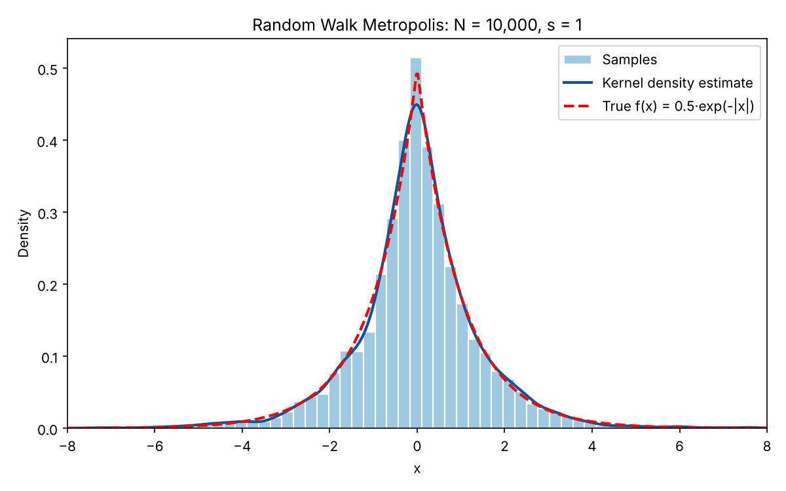
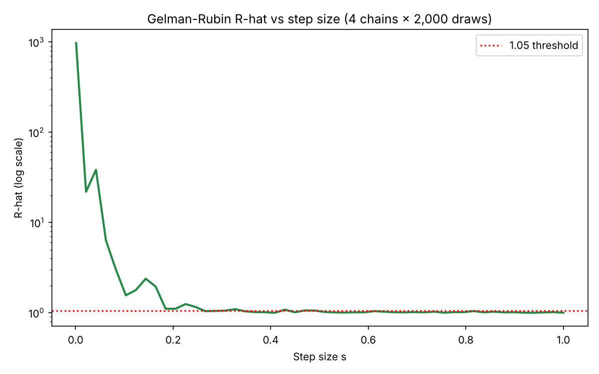
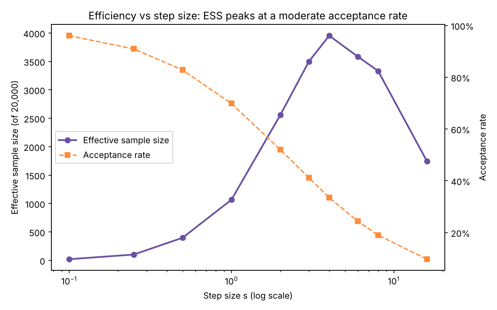
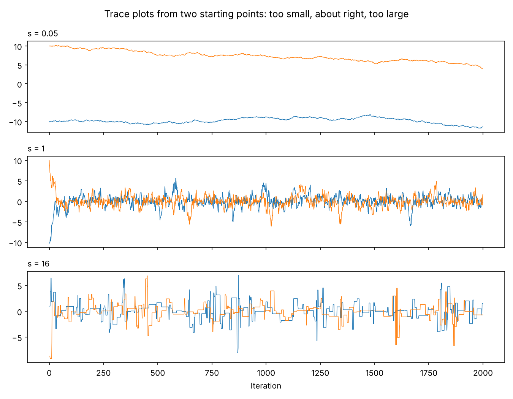

# Random Walk Metropolis: MCMC sampling and convergence tuning

A from-scratch Markov chain Monte Carlo sampler in Python and R, with a Gelman-Rubin convergence check and an efficiency study showing how the step size makes or breaks the sampler.



## The problem

Many models in statistics and finance produce probability distributions you can write down but cannot sample from directly. MCMC solves this by building a random walk whose long-run behaviour matches the target distribution. The catch is tuning: the same algorithm can give excellent or useless results depending on one number, the step size. This project implements the sampler, checks when it can be trusted, and measures how efficient it is.

The target here is the Laplace density f(x) = ½·e^(−|x|), which has a known mean (0) and standard deviation (√2 ≈ 1.414), so every result can be checked against the truth.

## Key findings

- **The sampler works.** 10,000 draws with step size 1 give a mean of 0.016 and an SD of 1.409, against true values of 0 and 1.414.
- **Tiny steps never converge.** With four chains started far apart, R-hat is about 975 at s = 0.001. It first drops below the usual 1.05 threshold at s ≈ 0.27, and stays below it for every step size from s ≈ 0.51 to 1.
- **"Converged" does not mean "efficient".** Raising the step size from 1 to 4 lifts the effective sample size from about 1,070 to about 3,950 out of 20,000 draws, nearly 4× more information for the same run time. Going larger still (s = 16) cuts it by more than half, because most proposals are rejected.
- **The best acceptance rate is moderate.** Effective sample size peaks when about a third of proposals are accepted (s ≈ 4). At s = 1, about 70% are accepted, but each move is small.

All numbers come from `python/metropolis.py` with seed 42. They shift slightly with other seeds.

## Method

**Random Walk Metropolis.** At each step, propose x* = x + ε with ε ~ Normal(0, s²). Accept it with probability min(1, f(x*)/f(x)), otherwise stay put. The ratio is computed on the log scale to avoid numerical underflow in the tails.

**Convergence: Gelman-Rubin R-hat.** Run 4 chains of 2,000 draws from dispersed starting points (drawn from Normal(0, 10²)) and compare between-chain and within-chain variance. Values near 1 mean the chains agree, and values above 1.05 mean they have not mixed yet.



**Efficiency: effective sample size (ESS).** Successive MCMC draws are correlated, so 20,000 draws are worth fewer than 20,000 independent ones. ESS estimates how many, using autocorrelations summed until they turn negative (Geyer's initial positive sequence).



| Step size s | Acceptance rate | ESS (of 20,000) |
|---|---|---|
| 0.1 | 96.1% | 21 |
| 0.5 | 82.8% | 398 |
| 1 | 69.9% | 1,067 |
| 2 | 52.0% | 2,558 |
| **4** | **33.5%** | **3,954** |
| 8 | 19.0% | 3,334 |
| 16 | 9.7% | 1,743 |

The trace plots show why. Small steps crawl and the two chains never meet. Large steps get stuck on the same value for long stretches. A moderate step mixes quickly.



## Tech stack

- **Python:** NumPy, SciPy (kernel density estimate), Matplotlib, pytest
- **R:** base R, ggplot2

## Design decisions

- **Log-scale acceptance ratio.** Comparing log densities avoids underflow when the chain is far in the tails.
- **Dispersed starting points for R-hat.** Starting all chains at 0 would make R-hat look fine even when the chains cannot move. Spreading them out is what makes the check meaningful.
- **ESS alongside R-hat.** R-hat answers "can I trust this?" ESS answers "how much is it worth?" The coursework only asked for the first. The second is what decides the step size in practice.
- **Pre-drawn random numbers.** Proposals and uniform draws are generated in one vectorised call before the loop, which keeps the Python loop simple and fast.

## Project structure

```
├── python/metropolis.py    # Sampler, R-hat, ESS, all charts
├── r/metropolis.Rmd        # Original R implementation (coursework)
├── tests/                  # Checks on the sampler, R-hat and ESS
├── images/                 # Charts used in this README
└── requirements.txt
```

## How to run

```bash
pip install -r requirements.txt
python python/metropolis.py   # prints results, saves charts to images/
pytest tests                  # 4 tests
```

For the R version, open `r/metropolis.Rmd` in RStudio and knit it (needs `ggplot2`).

## What I learned

- A diagnostic passing is not the same as a method working well. R-hat was below 1.05 at s = 1, yet that setting used only about a quarter of the information available at s = 4.
- Tuning trades off two failure modes. Small steps are almost always accepted but go nowhere. Large steps go far but are almost always rejected.
- Testing against a distribution with known answers makes it possible to verify the code, not just eyeball the plots.

## Next steps

- Tune the step size automatically during a burn-in phase to target an acceptance rate.
- Apply the sampler to a Bayesian model with real data, such as estimating the volatility of daily stock returns.

## About

Built for ST2195 Programming for Data Science (University of London, BSc Data Science and Business Analytics, 2026), then extended with effective sample size analysis, trace plots and tests. Part 2 of the same coursework is the [flight delay prediction](https://github.com/mattimathics/flight-delay-prediction) project.

## License

MIT
